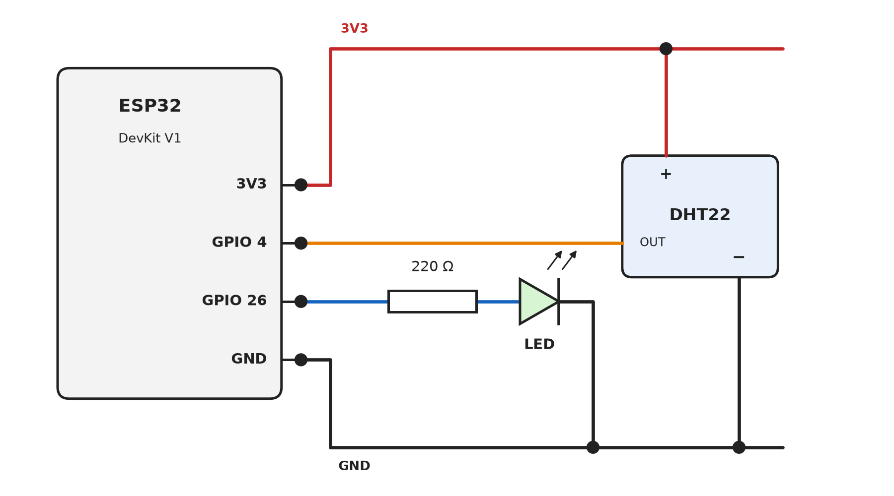

# ESP32 DevKit V1

[Kembali ke README](../README.md)

Board bawaan modul praktikum: ESP32-WROOM-32 dengan WiFi dan BLE 4.2.

## Rangkaian

Rangkaian ini mengikuti modul. Pin 3V3 dan GND dari ESP32 menjadi sumber daya bersama untuk LED dan DHT22.

| Komponen | Pin komponen | Tersambung ke |
|---|---|---|
| LED | Anoda (kaki panjang), lewat resistor 220 Ω | GPIO 26 |
| LED | Katoda | GND |
| DHT22, modul 3 pin | + | 3V3 |
| DHT22, modul 3 pin | OUT | GPIO 4 |
| DHT22, modul 3 pin | − | GND |

Jika DHT22 berupa sensor 4 kaki tanpa PCB, pasang resistor 10 kΩ antara kaki DATA dan 3V3. Modul 3 pin tidak memerlukannya karena resistor pull-up sudah ada di PCB-nya.

## Pengaturan Arduino IDE

Atur di menu **Tools** sebelum upload:

| Opsi | Nilai |
|---|---|
| Board | ESP32 Dev Module |
| Partition Scheme | Huge APP (3MB No OTA/1MB SPIFFS), wajib untuk `p3_ble_mqtt` |

## Port USB

- Jika port COM tidak muncul, pastikan kabelnya kabel data, bukan kabel charger saja, lalu pasang driver sesuai chip di board (CP210x atau CH340).
- Jika upload macet di *Connecting...*: tahan tombol BOOT sampai proses upload berjalan, lalu lepas.
