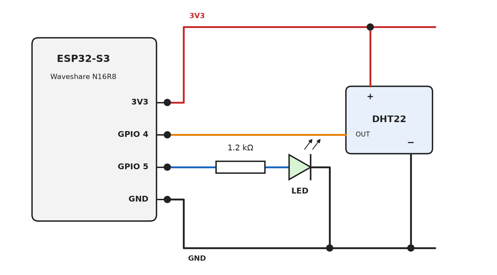

# Waveshare ESP32-S3 N16R8

[Kembali ke README](../README.md)

Board yang dipakai Kelompok 1: ESP32-S3 dengan flash 16 MB dan PSRAM 8 MB (octal).

## Rangkaian

Board dipasang melintang di breadboard, satu baris pin di tiap sisi. Pin 3V3 dan GND disalurkan ke satu kolom breadboard, lalu LED dan DHT22 mengambil daya dari kolom tersebut.

| Komponen | Pin komponen | Tersambung ke |
|---|---|---|
| LED | Anoda (kaki panjang), lewat resistor 1,2 kΩ | GPIO 5 |
| LED | Katoda | GND |
| DHT22, modul 3 pin | + | 3V3 |
| DHT22, modul 3 pin | OUT | GPIO 4 |
| DHT22, modul 3 pin | − | GND |

### Perbedaan dari modul

- **LED di GPIO 5, bukan GPIO 26.** Pada ESP32-S3, GPIO 26–32 dipakai flash/PSRAM, dan GPIO 35–37 dipakai PSRAM octal. Firmware memilih GPIO 5 secara otomatis saat dikompilasi untuk ESP32-S3.
- **Resistor LED 1,2 kΩ, bukan 220 Ω.** Arusnya lebih kecil sehingga LED sedikit lebih redup, tetapi tetap aman dan terlihat jelas.
- **Tanpa resistor pull-up untuk DHT22.** Modul 3 pin sudah membawa resistor pull-up di PCB-nya.

## Pengaturan Arduino IDE

Atur di menu **Tools** sebelum upload:

| Opsi | Nilai |
|---|---|
| Board | ESP32S3 Dev Module |
| Flash Size | 16MB (128Mb) |
| PSRAM | OPI PSRAM |
| Partition Scheme | Huge APP (3MB No OTA/1MB SPIFFS) |
| USB CDC On Boot | Lihat bagian port USB di bawah |

## Port USB

Banyak board ESP32-S3 punya dua port USB-C, berlabel USB dan UART. Waveshare yang saya pakai punya satu USB-C namun ada 2 COM port, saya menggunakan COM10 CH340. 

- **Port UART (disarankan):** chip USB-serial menangani upload dan Serial Monitor. Atur *USB CDC On Boot* ke **Disabled**. Jika port COM tidak muncul, pasang driver sesuai chip di board (CH343 atau CH340).
- **Port USB, atau board hanya punya satu port:** ini USB bawaan ESP32-S3. Atur *USB CDC On Boot* ke **Enabled**, karena tanpanya Serial Monitor akan kosong.

Jika upload macet di *Connecting...*: tahan tombol BOOT, tekan dan lepas RESET, lalu lepas BOOT.
